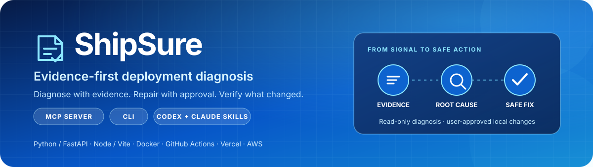

<p align="center">
  
</p>

<p align="center">
  <a href="https://github.com/Nikhila-Dhevi-R/ShipSure/actions/workflows/ci.yml"></a>
  <a href="LICENSE"></a>
  
  
</p>

<p align="center">
  
  
  
  
  
</p>

<p align="center"><strong>Diagnose with evidence. Repair with approval. Verify what changed.</strong></p>

ShipSure is an open-source deployment diagnosis toolkit with a standalone CLI, a read-only MCP server, and Agent Skills for OpenAI Codex and Claude Code. Its deterministic engine correlates project files, deployment configuration, logs, and read-only provider evidence to produce ranked findings with cited evidence, confidence, safe recommendations, and verification steps.

ShipSure does not send project data to an LLM. If the evidence does not match a known rule, it reports the result as inconclusive instead of claiming the deployment is healthy.

## Contents

- [Highlights](#highlights)
- [Supported platforms](#supported-platforms)
- [Quick start](#quick-start)
- [CLI](#cli)
- [MCP server and Agent Skills](#mcp-server-and-agent-skills)
- [Provider setup](#provider-setup)
- [Safety and verification](#safety-and-verification)
- [Development](#development)
- [Current boundaries](#current-boundaries)
- [License](#license)

## Highlights

- **Evidence-based diagnosis:** deterministic rules; source and log locations; confidence; plausible alternatives; and concrete next steps.
- **Cross-environment correlation:** compare application code, dependency manifests, deployment configuration, and supplied or provider-read logs.
- **Safe repair workflow:** preview exact file changes, require approval, create a private rollback copy, and refuse to overwrite newer edits.
- **Verification with clear scope:** run approved, allowlisted local checks and report the actual result. A local check is never presented as proof of a healthy deployment.
- **One engine, several interfaces:** the CLI and MCP tools use the same diagnostic and provider services.
- **Extensible integrations:** add providers through the normalized `ProviderReport` interface.

## Supported platforms

| Platform | What ShipSure inspects |
| --- | --- |
| **Python / FastAPI** | Import failures, dependency declarations, Uvicorn startup targets, and module-path mismatches. |
| **Node.js / React / Vite** | Package manifests and scripts, missing build tools, dependency-install issues, and common startup failures. |
| **Docker / Compose** | Docker and Compose configuration plus supplied build, entrypoint, port, architecture, and health-check logs. |
| **GitHub Actions** | Workflow configuration and supplied action or job failure logs. ShipSure does not fetch Actions logs from GitHub. |
| **Vercel** | Project and deployment configuration, deployment state and events, environment-variable names/types/targets, serverless errors, and runtime logs. |
| **AWS** | EC2 status checks; ECS services and deployment events; Lambda configuration and CloudWatch logs; named CloudWatch log groups; scoped IAM role policies; CloudFormation status and events. |

The rule engine includes fixtures for 26 realistic failure scenarios across these environments. Unknown failures remain inconclusive.

## Quick start

ShipSure requires Python 3.11 or newer. PyPI publishing is not set up yet, so install from this repository:

```bash
git clone https://github.com/Nikhila-Dhevi-R/ShipSure.git
cd ShipSure
python -m venv .venv
```

Activate the environment, then install ShipSure with the MCP and AWS integrations:

```powershell
# Windows PowerShell
.\.venv\Scripts\Activate.ps1
python -m pip install -e ".[all]"
```

```bash
# macOS / Linux
. .venv/bin/activate
python -m pip install -e '.[all]'
```

Run a local diagnosis:

```bash
shipsure diagnose --root .
shipsure diagnose --root . --log-file deploy.log --platform vercel --format json
```

The project-only package is available with `python -m pip install -e .`; optional extras can be installed separately with `.[mcp]` or `.[aws]`.

## CLI

```bash
# Diagnose files and optional deployment logs. Does not execute project code.
shipsure diagnose --root .
shipsure diagnose --root . --log-file deploy.log --platform aws

# Inventory declared dependencies and environment-variable names.
shipsure dependencies --root .
shipsure env-check --root .

# Inspect Vercel deployment state or runtime logs.
shipsure vercel deployment dpl_your_deployment --project-id your_project
shipsure vercel runtime-logs dpl_your_deployment --project-id your_project --since 1h --limit 100

# Apply a deterministic diagnosis proposal after reviewing and approving its preview.
shipsure apply-proposal --root . --log-file deploy.log --finding 1

# Run a local check only after reviewing the command.
shipsure verify --root . --command "python -m pytest"
```

`apply-proposal` currently automates one unambiguous correction: a FastAPI/Uvicorn startup module-path mismatch. Other findings include recommendations and can be handled with the guarded `fix-preview` / `fix-apply` text-replacement workflow. Applying, rolling back, and running project checks require user approval; the CLI can use `--approve` for explicit non-interactive approval.

For the full command list, run `shipsure --help`, `shipsure vercel --help`, or `shipsure aws --help`.

## MCP server and Agent Skills

Start the MCP server over stdio for Codex, Claude Code, or another MCP client:

```bash
shipsure-mcp
```

ShipSure exposes 19 tools for local diagnosis, dependency and environment-name inventory, Docker and CI log analysis, safe-fix previews, Vercel reads, and resource-scoped AWS reads. MCP tools are read-only. They do not edit files or run project commands because tool annotations are not a reliable approval mechanism.

The included project-level Agent Skills are:

- Codex: [`.agents/skills/shipsure/SKILL.md`](.agents/skills/shipsure/SKILL.md)
- Claude Code: [`.claude/skills/shipsure/SKILL.md`](.claude/skills/shipsure/SKILL.md)
- Canonical copy: [`skills/shipsure/SKILL.md`](skills/shipsure/SKILL.md)

Install the skills into another project with:

```bash
shipsure install-skill --client both --root /path/to/project
```

The installer asks before replacing customized skill files. Use `--force` only when you intend to replace them.

Configuration examples are in [`examples/codex.config.toml`](examples/codex.config.toml) and [`examples/claude.mcp.json`](examples/claude.mcp.json). The server restricts project paths to its starting directory; set `SHIPSURE_WORKSPACE_ROOT` if the client needs a different workspace root. Streamable HTTP is available for local use and binds to loopback only:

```bash
shipsure-mcp --transport streamable-http --host 127.0.0.1 --port 8765
```

## Provider setup

### Vercel

For REST reads, set `VERCEL_TOKEN` in the server or CLI process environment. Use a read-scoped token for the relevant project/team. ShipSure discards environment `value` fields and reports names, types, and targets only. Runtime logs require an already-installed and authenticated Vercel CLI; ShipSure runs bounded `vercel logs` reads and will not install or update it.

### AWS

Install the `aws` extra and configure boto3’s standard credential chain or a named profile. Supply a region and explicit resource identifiers. The adapter performs scoped read operations only; CloudWatch log retrieval sets `unmask=False`. See [`docs/provider-permissions.md`](docs/provider-permissions.md) for the action list and a least-privilege policy example.

## Safety and verification

- Project files, logs, and provider responses are treated as untrusted input. Diagnosis never executes them.
- Inspection is bounded by file count and size; `.env` files, keys, dependency trees, build outputs, caches, and VCS folders are skipped.
- Secret-like values are redacted. Vercel environment values are never included in reports.
- AWS reads are scoped to named resources. ShipSure does not deploy, invoke workloads, mutate cloud resources, or simulate IAM policies.
- File edits must be small, unambiguous, in-root, and free of credential-like content. They require approval, retain a private backup, and refuse stale rollbacks.
- Verification commands are allowlisted, run without a shell, have a hard timeout, strip common secret-bearing environment variables, and redact captured output.
- “Locally verified” and “deployment verified” are separate claims. ShipSure performs local checks and read-only deployment observations; it does not deploy a change or declare deployment health from a local build.

For details, see the [security model](docs/security.md) and [architecture](docs/architecture.md).

## Development

```bash
python -m venv .venv
python -m pip install -e '.[all,dev]'
python -m unittest discover -s tests -v
ruff check src tests
ruff format --check src tests
mypy src
python -m build
```

Provider tests use controlled fake clients and HTTP transports; they do not require live credentials or contact production accounts. CI is configured for Windows and Ubuntu with Python 3.11–3.14.

See [`CONTRIBUTING.md`](CONTRIBUTING.md) for development guidance. Report security issues using the process described in [`SECURITY.md`](SECURITY.md).

## Current boundaries

- Diagnosis is deterministic and rule-based; ShipSure does not claim to infer root causes that its evidence does not support.
- Automatic repair is currently limited to the documented FastAPI/Uvicorn startup-path proposal. Other failures receive evidence-backed recommendations and guarded manual edit tools.
- GitHub Actions, Docker, and local application logs are analyzed from supplied logs and project files; ShipSure does not fetch those logs from the associated services.
- Live provider access depends on user credentials and account permissions. Provider behavior has not been validated against production accounts.
- External deployment verification is observational only. ShipSure does not deploy or alter cloud resources.
- The package is not yet published to PyPI; install from source using the steps above.

## License

ShipSure is released under the [MIT License](LICENSE).
